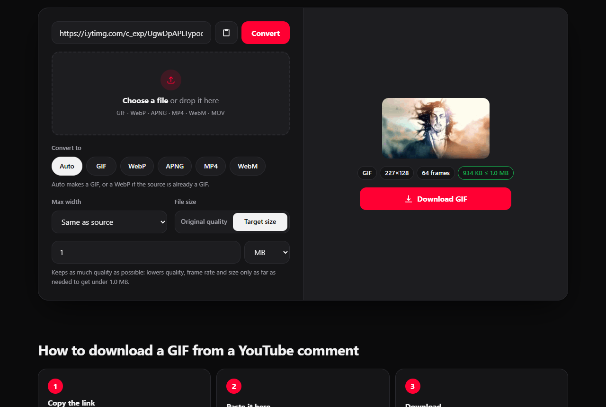
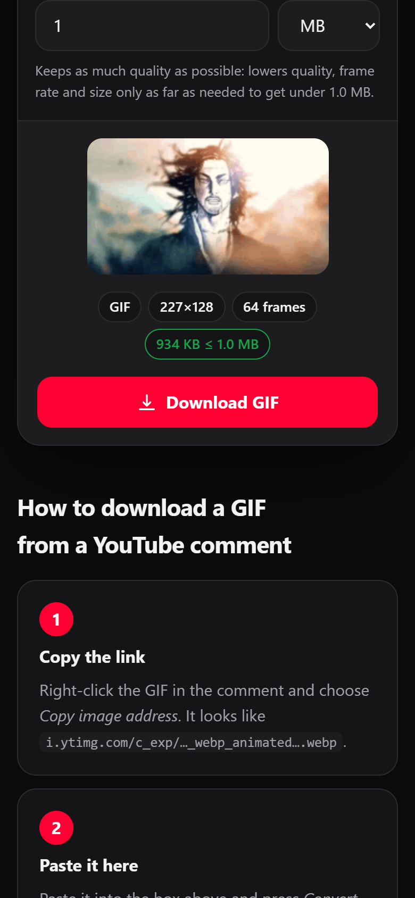

<p align="center">
  
</p>

<h1 align="center">YouTube GIF Downloader</h1>

<p align="center">
  Save YouTube comment GIFs as real GIFs. Convert between GIF, WebP, APNG, MP4 and WebM, entirely in your browser.
</p>

<p align="center">
  <a href="https://hamzayslmn.github.io/Youtube-Gif-Downloader/"><strong>Open the app →</strong></a>
</p>

<p align="center">
  <a href="https://github.com/HamzaYslmn/Youtube-Gif-Downloader/actions/workflows/pages.yml"></a>
  
  <a href="https://github.com/sponsors/HamzaYslmn"></a>
</p>

<p align="center">
  
  
</p>

## Overview

YouTube comment GIFs download as animated `.webp` files, which many apps won't treat as GIFs. This tool converts them into a real GIF, or another format, without uploading anything.

- **Private.** Everything happens on your device. There is no server.
- **Any format.** Inputs: GIF, WebP, APNG, PNG, JPEG, MP4, WebM, MOV. Outputs: GIF, WebP, APNG, MP4, WebM.
- **Target file size.** Set a limit in KB, MB or GB, and the output keeps as much quality as fits. The default is original quality.
- **Fast.** Frames are encoded in parallel across your CPU cores.
- **Responsive.** Works on phones, tablets, desktops and foldables, in light and dark mode.

## Usage

1. On YouTube, right-click a GIF in a comment and choose **Copy image address**.
2. Paste it into the [app](https://hamzayslmn.github.io/Youtube-Gif-Downloader/) and press **Convert**.
3. Press **Download**.

You can also drop or paste a file. To link straight to a conversion, use `?url=<link>&to=gif|webp|apng|mp4|webm`.

## Browser support

Works in recent Chrome, Edge, Opera and Firefox. Safari can only convert video inputs, because it doesn't support `ImageDecoder` yet.

## Development

Requires Node 24+ and pnpm.

```bash
pnpm install
```

```bash
pnpm dev
```

```bash
pnpm test
```

```bash
pnpm build
```

Built with React, Vite and TypeScript. GIF encoding uses [gifenc](https://github.com/mattdesl/gifenc), and video uses [Mediabunny](https://mediabunny.dev). YouTube links are loaded through the [wsrv.nl](https://wsrv.nl) image proxy, because YouTube blocks direct downloads from other sites.

## Sponsor

If this project is useful to you, consider [sponsoring it on GitHub](https://github.com/sponsors/HamzaYslmn).

## Disclaimer

Not affiliated with YouTube or Google. Only download content you have the right to use.
